# Auditoria da tela de gestão — 13/11/2026

Feita olhando o sistema de teste rodando (API 8001, banco `gestor_pecas_test`). Nenhum código foi alterado.

## Como foi feita

- Criei 48 contas temporárias, uma por nível. **Todas já foram desativadas** (conferido: 0 ativas). Nada mais foi gravado.
- Cada conta entrou no sistema e percorreu todo o menu e todas as abas, em tela grande (1920×1080).
- As 10 telas mais usadas foram repetidas em telas menores: notebook (1366), monitor pequeno (1024), tablet em pé (768) e celular (390).
- Testei navegação só pelo teclado (tecla Tab) na Tela inicial e no Andon.
- Contei quantas consultas ao servidor cada tela faz, para achar lentidão.

Limites desta auditoria, para você saber:
- O banco de teste tem pouca produção hoje. Por isso o Andon aparece vazio e várias telas mostram "Sem registros". Não consegui ver o Andon cheio.
- Duas contas de estação de solda (5 e 8 do aço) não abriram nenhuma tela no percurso automático. Acho que foi falha do meu robô, não do sistema, mas não conferi.
- Contraste: a medição automática não achou texto principal ilegível. Não medi um a um os textos cinza pequenos; o problema deles é o tamanho (item 4).

## O que cada conta enxerga

- **Admin e Desenvolvedor**: tudo (34 telas).
- **Qualidade**: 21 telas (inclui Cotas padrão, SPC e Decisão de RNC).
- **Diretoria, Manufatura, Melhoria Contínua**: 19 telas cada (o comum + a sua).
- **Gestor, Líder, Supervisor, PCP, Controladoria, Gerente industrial, Projetos adm., Líder do almoxarifado**: 18 telas, todas comuns.
- **Líderes e supervisores de área** (Dobra e Corte, Serra, Usinagem, Pintura, Solda, Protótipo, Projetos/Ferramentaria): as 18 comuns + a tela da sua área.
- **Manutenção**: só a tela "Sugestões de manutenção".
- **Operadores e estações** (22 contas): só a bancada do operador.
- **Andon**: só o painel Andon.

---

## Problemas, do mais grave ao mais leve

### 1. Números impossíveis na primeira tela que o gestor vê
**Onde:** Tela inicial, Relatórios, Produção realizada, Diretoria.
**O que acontece:** aparece "OEE 134,6%", "Performance 204,1%", "Eficiência de 1.331,2%", "Desvio do tempo padrão -98,8%". Um percentual acima de 100% faz o gestor desconfiar do sistema inteiro. O aviso que acompanha é técnico: "investigar tempo padrão, unidade, simultaneidade ou duplicação de apontamentos".
**Observação:** o cálculo é regra do sistema e não muda. O que falta é a tela dizer, em português simples, "este número está acima do possível; provável causa: tempo padrão cadastrado baixo" e destacar isso como alerta, não como resultado.
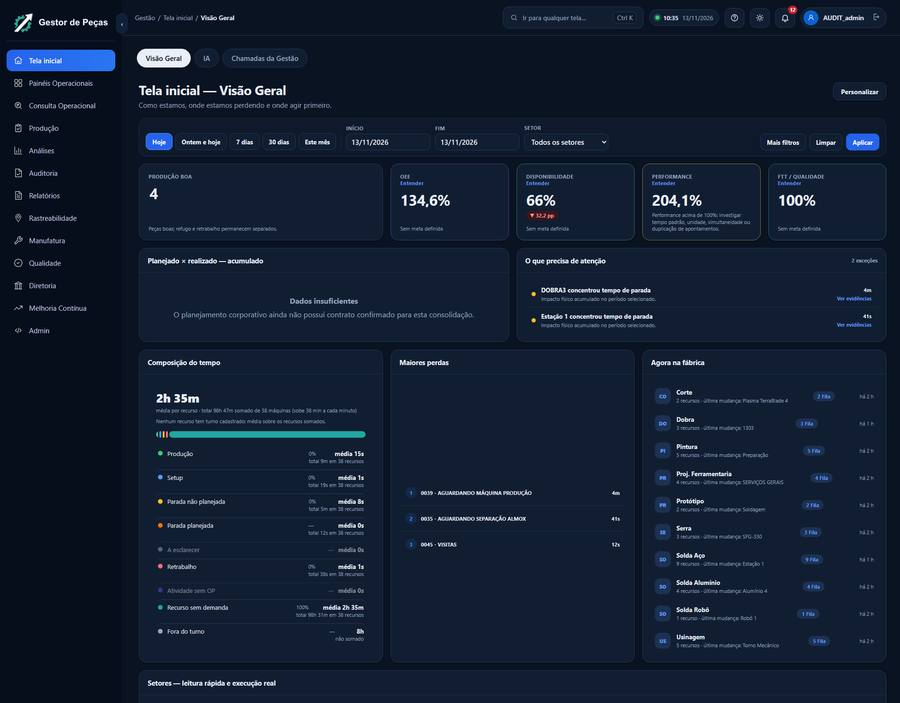
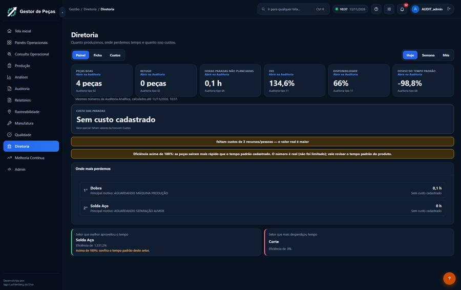

### 2. Número sem explicação, ou com explicação que confunde mais
**Onde:** Tela inicial, Horas & Utilização, Execução das OPs, Cotas padrão, Lote/Material/Nesting.
**Exemplos:**
- "403h 10m" para o dia de hoje (é a soma de 38 máquinas, mas isso só aparece em letra miúda).
- "2h 35m média por recurso - total 98h 47m somado de 38 máquinas" e "média 15s / total 9m em 38 recursos" na mesma caixa.
- "Sem meta definida" repetido em 4 cartões.
- Colunas "Atendida", "Saldo", "% Atendida", "Prioridade" sem dizer o que são.
- "Op 20: 4", "5 (padrão)", "Voltar lote para 5".
- "Tempo atribuído bruto", "Sobreposição removida 0s".
- Mesma medida em unidades diferentes: "0,1 h" numa tela e "4m" em outra.
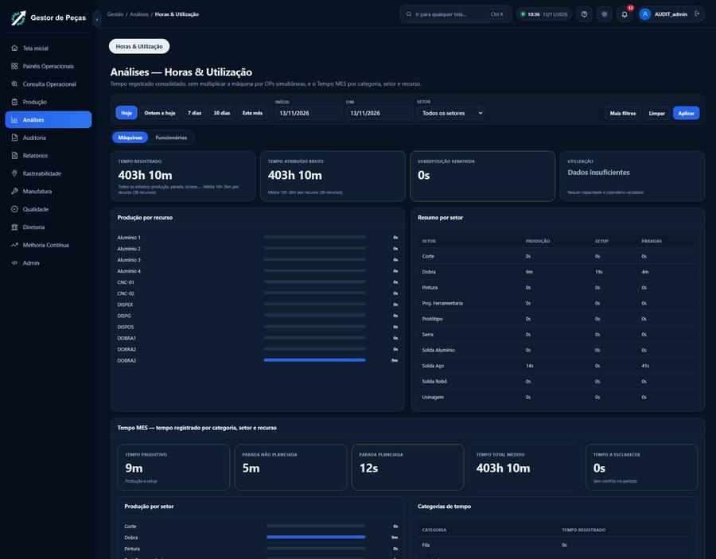
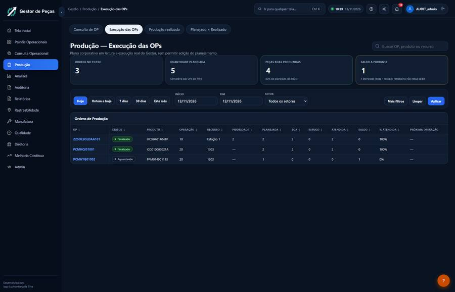
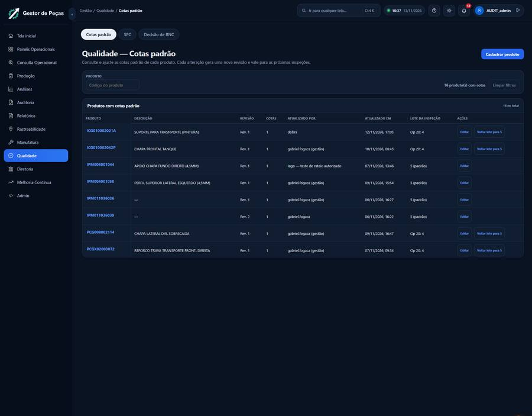

### 3. Avisos em linguagem de programador
**Onde:** várias telas.
**Exemplos:**
- "Dados insuficientes — O planejamento corporativo ainda não possui contrato confirmado para esta consolidação."
- "Dados insuficientes — Requer capacidade e calendário validados."
- "Referência (as_of)…" num parágrafo miúdo na Auditoria.
- "Drill-down da OP" na Consulta de OP.
- "Auditoria tipo 02/11/08/04" na Diretoria.
- Nomes crus de campo na tela Alterações: `codigo_op`, `apontamento_id`, `primeira_peca_id`.
- "Build do frontend", `web/dist`, `npm run build` na tela Sistema.
- "Cpk", "subgrupos" no SPC (aqui é aceitável: é tela de especialista, mas falta uma frase de apoio).
O funcionário não sabe o que aconteceu nem o que fazer.
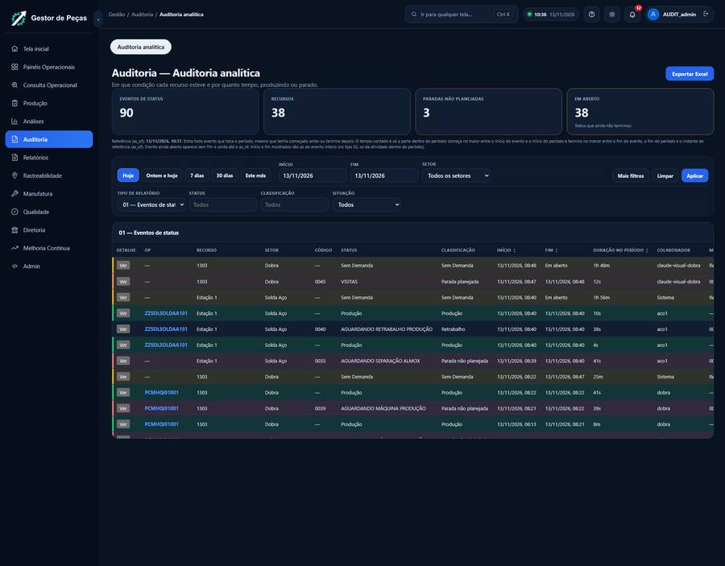
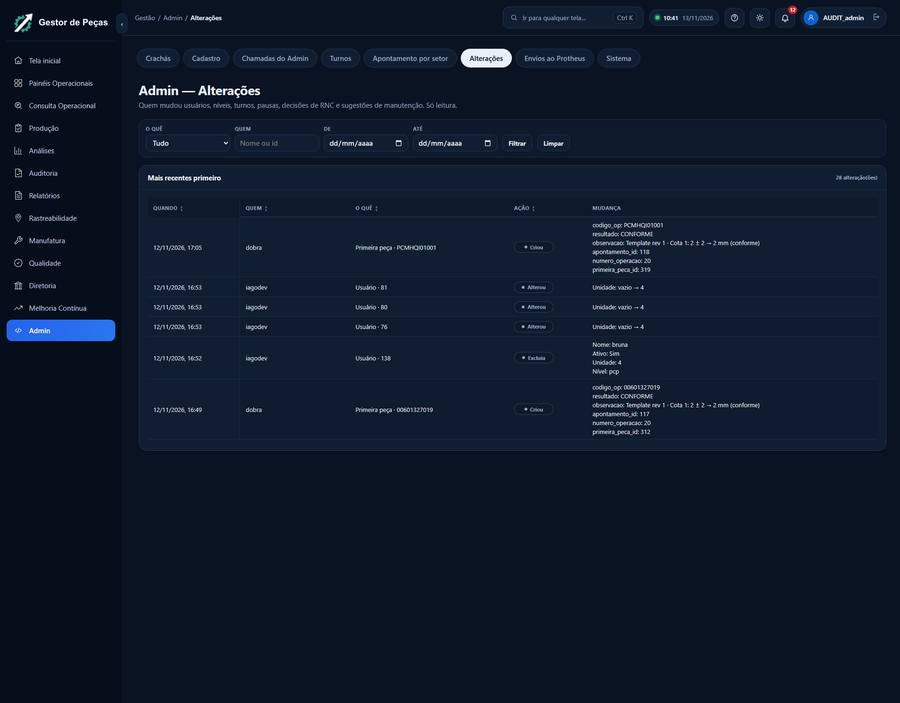
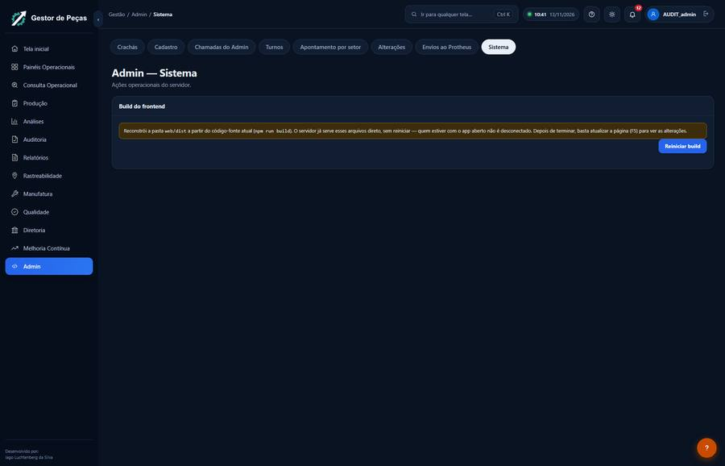

### 4. Letra pequena demais
**Onde:** todas as telas da gestão.
**O que acontece:** muito texto em 11px (169 trechos na Tela inicial, 623 no Cadastro). Rótulos dos cartões em MAIÚSCULAS pequenas e cinza. No Andon, "RECURSOS ATIVOS (0)" está em 10px e a hora da atualização é minúscula. No Mapa, as etiquetas das máquinas quase não se leem.
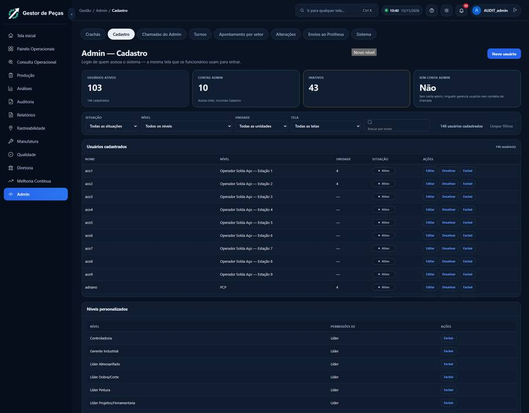
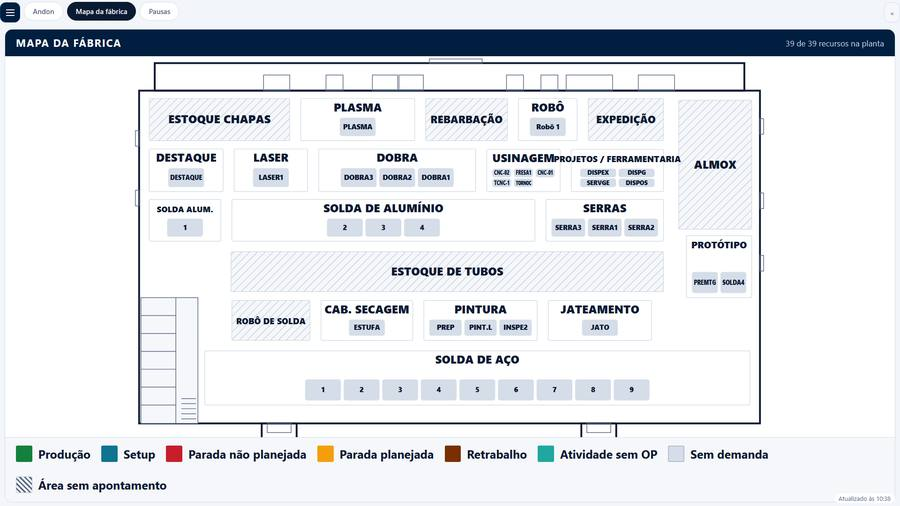

### 5. Cor de alarme para situação normal
**Onde:** Consulta Operacional (Visão Geral, Recursos, OPs em andamento) e telas de área.
**O que acontece:** "Recurso sem demanda" aparece em faixa vermelha, como se fosse defeito. E a mesma situação tem três nomes: "Fila", "Sem demanda" e "Recurso sem demanda". Na Tela inicial, os cartões têm bordas coloridas (verde, amarelo) sem legenda.
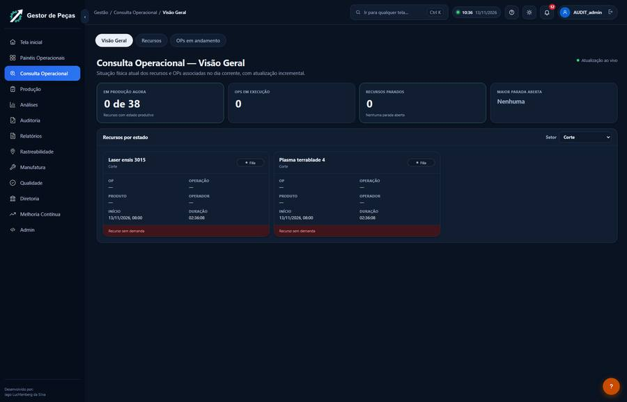
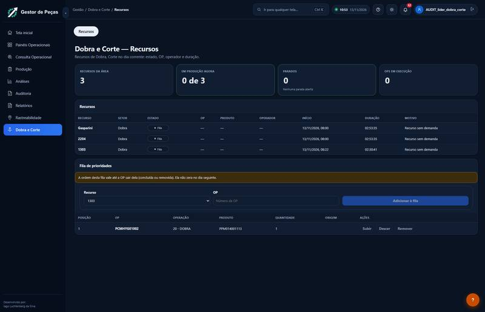

### 6. Cada tela parece de um sistema diferente
- **Tema:** a gestão é escura; o Andon e o Mapa são claros. Ao clicar no menu, a tela "pisca" de escuro para claro.
- **Busca:** na Consulta de OP o campo de busca quase não aparece e fica à esquerda; na Rastreabilidade e na Execução fica em outro lugar, com outro estilo.
- **Ordem dos blocos:** na Tela inicial os filtros vêm antes dos cartões; na Auditoria e na Execução os cartões vêm antes. (Sua regra é cartões em cima.)
- **Botão de exportar:** "Exportar Excel" numa tela, "Export técnico" e "Export simples" em outra.
- **Filtro de período:** a Diretoria usa um filtro diferente do resto.
- **Botões:** "Novo nível" no Cadastro é um botão cinza sem estilo, solto no cabeçalho.
- **Manual e Manutenção:** têm cabeçalho e visual próprios.
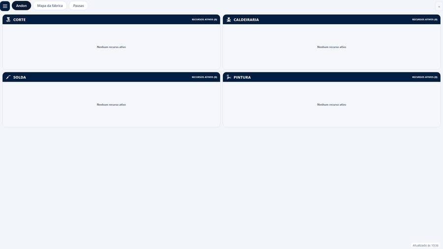
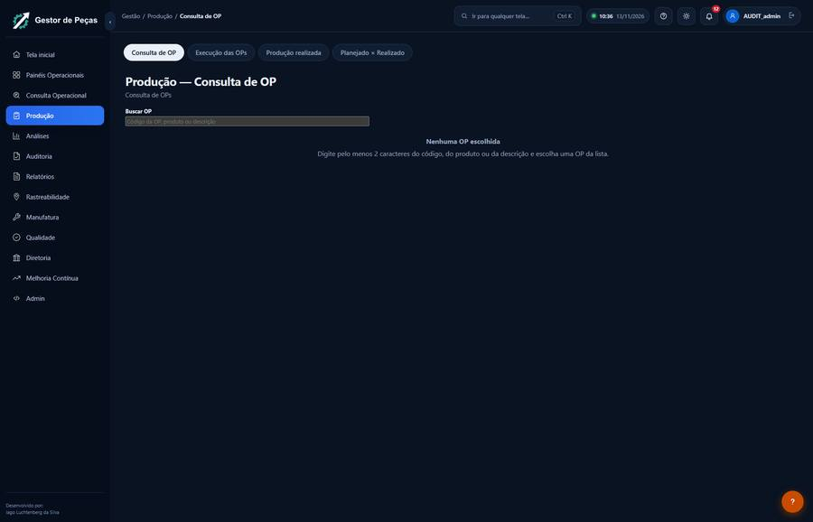
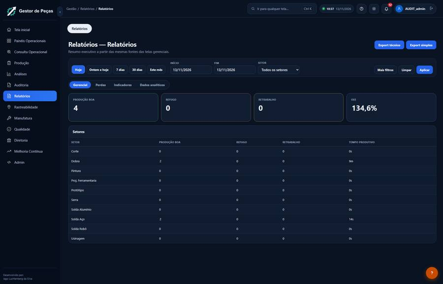
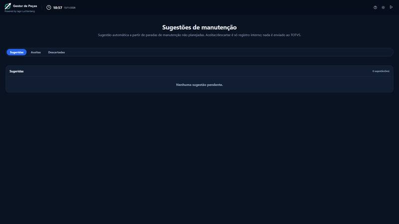

### 7. Telas lentas
**Onde:** Horas & Utilização, Tela inicial, Auditoria, Diretoria e as telas de área.
**O que medi:** Horas & Utilização faz mais de 100 consultas ao servidor para abrir; a Tela inicial, 72; a Diretoria, 79; a área Pintura, 129. Somando o tempo dessas consultas dá de 20 a 50 segundos (elas correm em paralelo, então a espera real é menor, mas a tela vai "pingando" os números). A Decisão de RNC ainda estava em "Carregando dados…" quando fotografei.
**Ressalva:** medi num notebook de teste, com meu robô abrindo 4 contas ao mesmo tempo. O número exato pode ser melhor no uso normal; a quantidade de consultas não muda.

### 8. Telas menores
- **Notebook (1366):** a tabela da Auditoria tem 12 colunas e a metade fica escondida à direita. A de Execução (13 colunas) também. Sem aviso de que há mais para o lado.
- **Tablet e monitor pequeno:** as abas do Admin não cabem e são cortadas. Tabelas continuam cortadas.
- **Celular:** a Tela inicial vira uma fila de mais de 5 telas de altura; os filtros ocupam a primeira tela inteira antes de qualquer número.
- **Mapa da fábrica:** os nomes "USINAGEM" e "PROJETOS / FERRAMENTARIA" ficam um em cima do outro.
- **Ponto bom:** o Andon se reorganiza bem no celular.
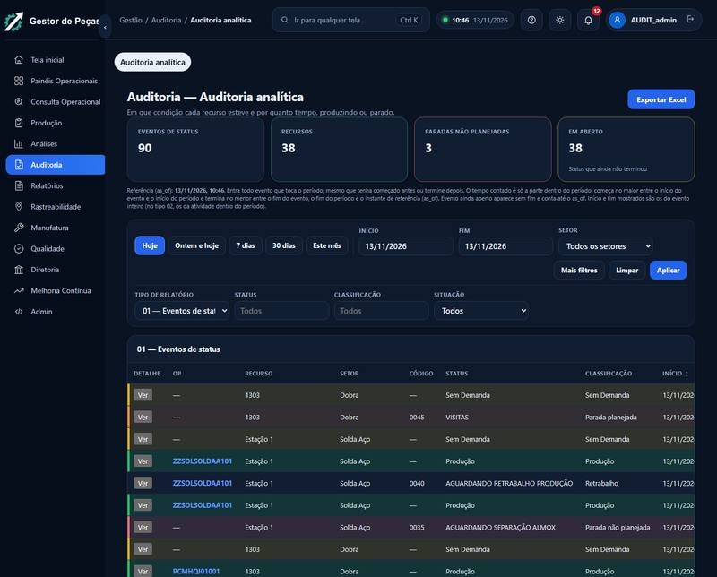
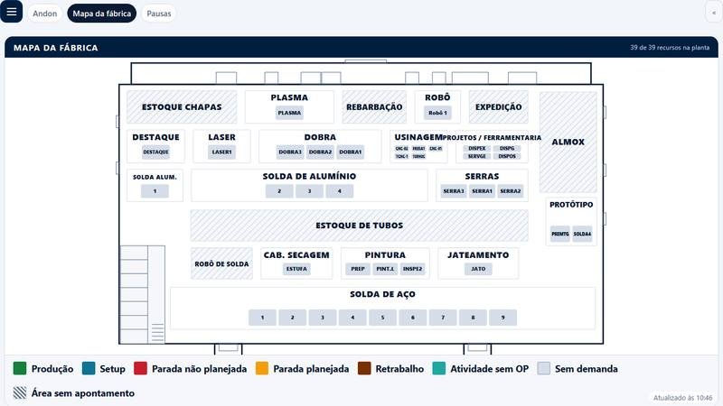
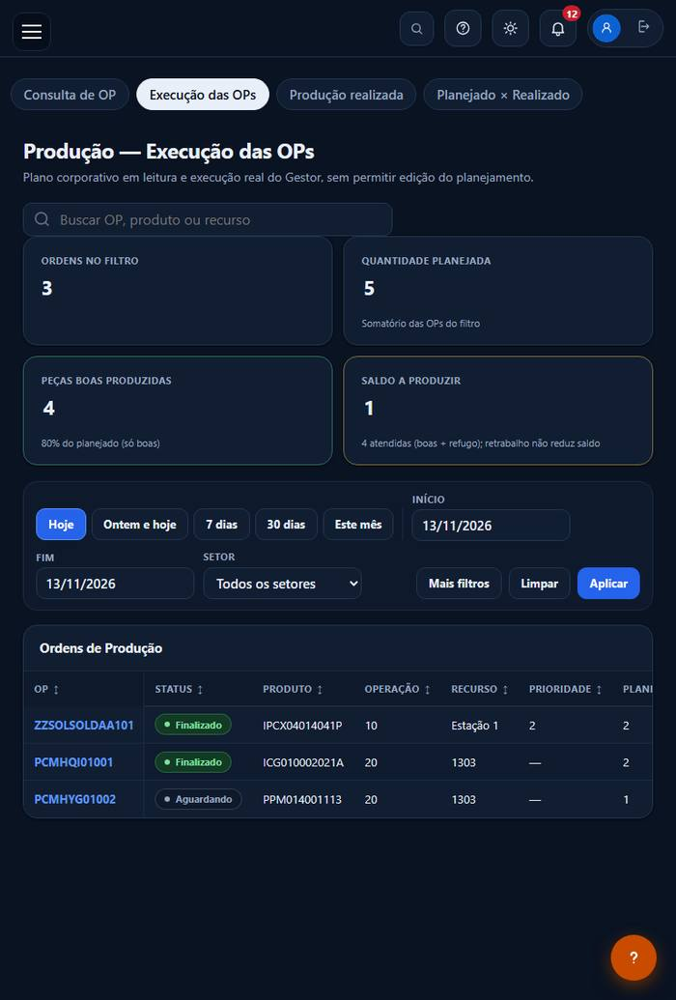
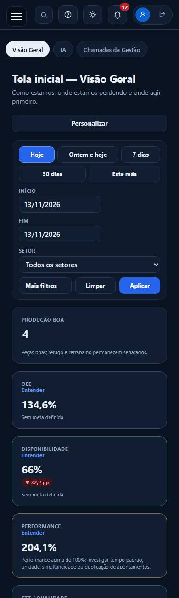

### 9. Sim/Não como se fosse número
**Onde:** Cadastro, Crachás, Chamadas do Admin.
**O que acontece:** cartões grandes "SEM CONTA ADMIN: Não", "SEM RESPONSÁVEL: Não", "SEM CONTATO CADASTRADO: Não". É uma negação dupla: a pessoa precisa parar para entender se está bom ou ruim.

### 10. Ações perigosas com o mesmo peso das comuns
**Onde:** Cadastro.
**O que acontece:** "Excluir" tem a mesma aparência de "Editar", lado a lado, em cada linha.

### 11. Menu com itens fora do lugar ou vazios
- **Manufatura** abre uma tela que diz "Nenhuma tela por enquanto".
- **Pausas** (uma tela de cadastro) fica dentro de "Painéis Operacionais", ao lado do Andon.
- A Tela inicial tem um grande espaço vazio no bloco "Maiores perdas".
- A tela Turnos abre com um parágrafo amarelo longo explicando a regra.
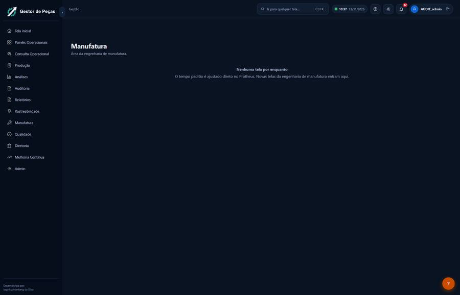
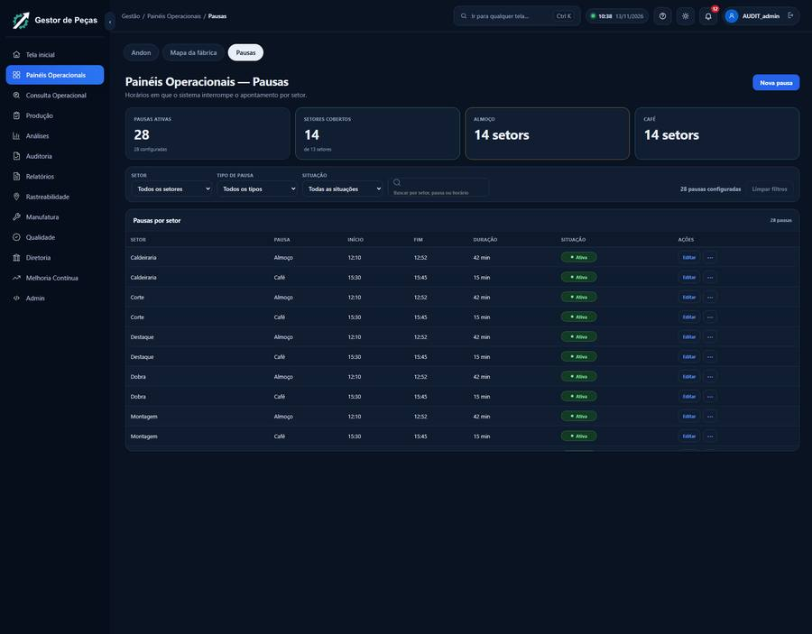
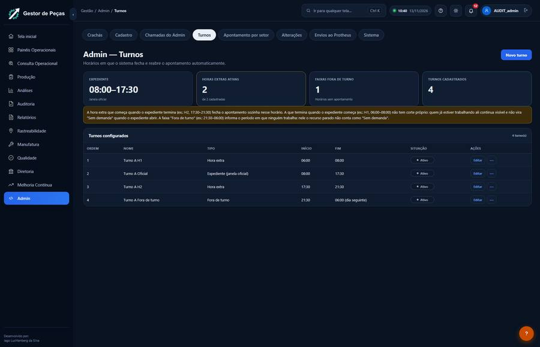

### 12. Teclado e clique
- **No Andon aberto no computador:** depois de 5 toques no Tab, o foco entra no menu que está escondido fora da tela. A pessoa aperta Tab e não vê onde está. Também não há "Pular para o conteúdo" ali.
- **Alvos pequenos:** o botão "Ver de onde vem este número" mede 22×32; há links de 1×1 ponto. Difícil de acertar com o dedo ou com mouse.
- **Andon e Mapa no computador:** têm botões flutuantes (☰ e «). Na TV isso não pode existir.

---

## O que já está bom (e deve ser mantido)

- Na gestão dá para usar tudo pelo teclado: existe "Pular para o conteúdo" e o foco aparece com contorno azul.
- O texto principal tem bom contraste.
- O sistema já respeita quem pede menos animação.
- A busca rápida "Ir para qualquer tela" (Ctrl K) é boa.
- A bancada do operador é limpa e direta.
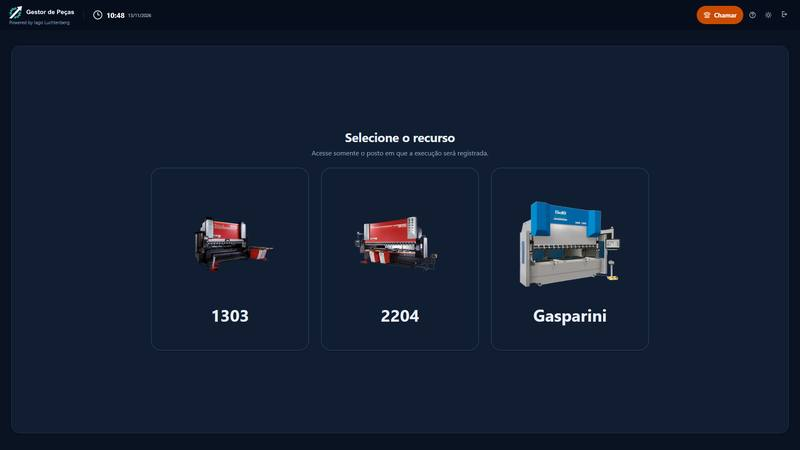

---

## Resumo em uma frase

O sistema funciona, mas fala a língua de quem o construiu: números sem contexto, avisos técnicos, letra miúda e telas que não parecem irmãs. O novo design precisa atacar primeiro os itens 1 a 6.
